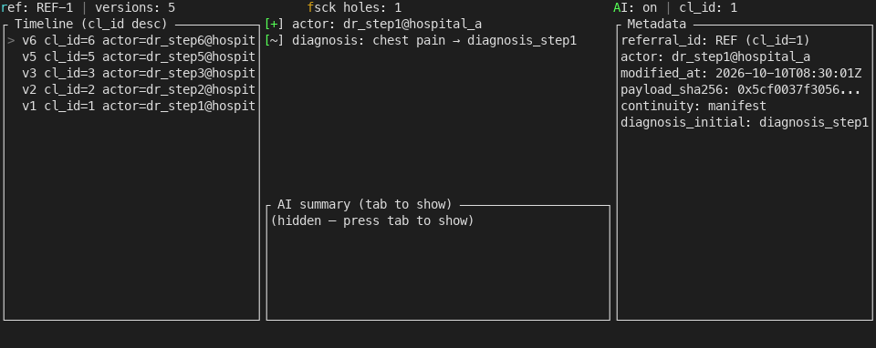

# Referral Trace Station

> Upload a version snapshot of a referral slip → automatically chain it by cl_id into a monotonic timeline → one-click export of a sha256-chained zip for the Medical Affairs Office to sign off → replay every modification and field change at any moment when post-discharge follow-up or medical-insurance audit calls.

## Target Scenarios / Roles

| Role | When to Use | What You Get |
|------|-------------|--------------|
| Medical Affairs Office referral window | When an upstream hospital initiates a referral and the other side submits multiple supplementary documents | A version timeline sorted by cl_id in descending order; each row shows who changed which field and when |
| Medical Records Room coder | When the insurance or auditor asks, post-discharge, "which step on this referral was changed by the other side" | Three-second pinpoint to the corresponding version number and sha256 digest + diff view |
| Insurance Office reconciliation | When cross-institution referrals and mutual-recognition checks lead to disputes | Export the entire zip along the timeline (manifest + all version snapshots + chain digest), manually signed off for evidence |
| Information Department | When HIS REST and the regional drop simultaneously deliver the same referral, conflicting with each other | The tool follows a static task graph to automatically decide which stream takes precedence and which takes the degradation path |

> **Table discipline**: This table only lists **role language + business moment + verifiable output**. Technical details such as HL7 ORU, FHIR JSON, sha256 chain, and `POST /v1/chat/completions` are kept in the "Commands / API / Configuration" section.

## Key Capabilities

- **Static task graph locks the referral lifecycle**: Four phases (created → modified → received → reviewed) are statically declared in Rust structs, preventing runtime tampering.
- **cl_id monotonic counter enforces version order**: Each referral holds its own u64 counter; the value resumes from persisted state after restart. Reordered events are rejected outright.
- **fsck sequence-hole detection**: When a contiguous ID range has missing entries, the top status bar immediately shows the first and last IDs plus the missing reason. More than 256 holes triggers a `truncated` flag.
- **Four-state continuity recording**: Manifest / Gap / RecoveryPoint / Finished. When interfacing with the regional platform drop, network drops or resends never fabricate a tail.
- **sha256 chain digest**: `prev_hash || canonical_json(this)`. Exported zips carry an `end of chain` marker at the tail of `chain.txt`, and the `verify` subcommand can recompute and compare.
- **OpenAI-compatible ModelGateway**: Structured prompt returns `{summary, fields_added, fields_removed, semantic_class}`. Timeout / parse failures automatically degrade to field diff. Calls are logged to `logs/audit.jsonl`.
- **Replay**: `cargo run -- replay --referral X` renders the entire archive back into a text timeline. If the chain is incomplete, an explicit `RecoveryPoint required` notice is shown.

## Quick Start

### Dependencies

- Rust **≥ 1.74** (edition 2021; required for `cargo build`)
- Only when network is unreachable: mock harness is self-contained, no real HIS / OpenAI required
- Credentials are read from `.env` (never hardcoded)

### Installation

```bash
cd referral-trace-station
cp .env.example .env   # Fill in HIS_TOKEN / OPENAI_API_KEY (may be left blank to use degradation)
cargo build --release
```

### Configuration

Key entries in `.env` (see "Commands / API / Configuration" for details):

| Configuration Item | Default | Description |
|--------------------|---------|-------------|
| `HIS_BASE_URL` | empty | HIS REST base URL; empty means use the drop directory path |
| `HIS_TOKEN` | empty | Credential injected via environment variable, not in code |
| `OPENAI_BASE_URL` | empty | ModelGateway endpoint; empty means `AI: off` |
| `OPENAI_API_KEY` | empty | Same as above; unconfigured means field diff only |
| `OPENAI_TIMEOUT_MS` | 4000 | Per-call model timeout |
| `RTS_INBOX_DIR` | `./inbox` | Hot-load directory for drop zips |
| `RTS_STATE_DIR` | `./state` | Persistence directory for cl_seq and sha256 chain |

### Build and Verification

```bash
cargo build --release --manifest-path referral-trace-station/Cargo.toml
cargo test  --manifest-path referral-trace-station/Cargo.toml --no-run
cargo test  --manifest-path referral-trace-station/Cargo.toml -- --skip perf:: --skip e2e::   # Quick regression
```

### Main Command Cheatsheet

```bash
cargo run -- trace                                            # Start ratatui three-pane view
cargo run -- replay --referral referral_001                   # CLI text timeline replay
cargo run -- export --referral referral_001 --out bundle.zip  # Export sign-off bundle
cargo run -- verify --zip bundle.zip                          # Recompute sha256 chain + tamper check
```

## Commands / API / Configuration

### Key Configuration Items

| Configuration Item | Default | Description |
|--------------------|---------|-------------|
| `HIS_BASE_URL` | empty | Base URL for `GET /referrals/{id}/snapshot` |
| `HIS_TOKEN` | empty | HIS auth token; missing value triggers immediate `HisCredentialMissing` |
| `REFERRAL_BASE_URL` | empty | Regional platform drop fallback base URL |
| `OPENAI_BASE_URL` | empty | ModelGateway endpoint; OpenAI-compatible |
| `OPENAI_API_KEY` | empty | Model credential; missing triggers degradation to field diff |
| `OPENAI_MODEL` | `gpt-4o-mini` | Model name, written into every audit row |
| `OPENAI_TIMEOUT_MS` | `4000` | Timeout; triggers degradation on expiry |
| `RTS_INBOX_DIR` | `./inbox` | notify-rs watcher directory |
| `RTS_STATE_DIR` | `./state` | Persistence directory for cl_seq and chain |
| `RTS_DEBOUNCE_MS` | `100` | Watcher debounce |

### CLI Subcommands / API Endpoints

| Command or Path | Purpose | Key Parameters |
|-----------------|---------|----------------|
| `cargo run -- trace` | Launch ratatui three-pane resident watcher | None |
| `cargo run -- replay --referral X` | CLI timeline replay | `--referral` referral slip ID |
| `cargo run -- export --referral X --out zip` | Export sign-off bundle | `--referral` `--out` |
| `cargo run -- verify --zip path` | Recompute chain + tamper check | `--zip` |
| `POST {HIS_BASE_URL}/referrals/{id}/snapshot` | HIS snapshot fetch | `Authorization: Bearer ${HIS_TOKEN}` |
| `POST {OPENAI_BASE_URL}/v1/chat/completions` | ModelGateway call | `Authorization: Bearer ${OPENAI_API_KEY}` |
| `GET  {REFERRAL_BASE_URL}/drop/{id}.zip` | Drop inbound (passive) | None, watcher monitors `RTS_INBOX_DIR` |

### Errors and Degradation

| Scenario | Behavior | Handling |
|----------|----------|----------|
| HIS 5xx or 4s timeout | StatusBar shows `HIS: down` | Auto-fallback to `RTS_INBOX_DIR` drop zip |
| HIS credential missing | `HisCredentialMissing` | Go straight to drop; do not send request |
| OpenAI unreachable | `AiUnavailable` event broadcast | DiffView still shows field diff in upper half |
| OpenAI response JSON missing fields | Validation fails → no write-back | Degraded diff + write `audit.jsonl: parse_failed` |
| Drop zip missing `signature.txt` | `SignatureMissing` rejects inbound | cl_seq not advanced, written to `inbox/unparsed/` |
| Upstream cl_id rollback | `observe()` returns `Err` | Logged to `logs/audit.jsonl`, state untouched |
| fsck over 256 holes | Top label shows `truncated` | Still reported truthfully; export zip carries the marker |

### Integration with Existing Systems

- **HIS**: `GET /referrals/{id}/snapshot` (REST / JSON), `Authorization: Bearer ${HIS_TOKEN}`, 4000ms timeout. Enabled only when the partner HIS exposes this endpoint; otherwise the drop directory is used directly.
- **Regional Platform**: Passively receives the other side pushing `inbox/<date>/*.zip`. Zip triplet is `before.json` + `after.json` + `signature.txt`. Missing signature → reject.
- **HL7 ORU**: Only fixed-length fields in MSH/PID/OBR/OBX are parsed. Parse-failed `.hl7` files fall into `inbox/unparsed/` and are tagged with `.unparsed`.
- **FHIR JSON**: Only three key fields are read — `referral.id` / `referral.modification.timestamp` / `referral.modification.actor`. Missing field returns `FhirMissingField`.
- **This tool does not write back to HIS directly**: All artifacts (`bundle.zip` / `replay.txt`) land locally or are uploaded after manual sign-off by the Medical Affairs Office.

## Typical Scenarios

### Scenario 1: Medical Affairs Office receives supplementary documents from an upstream hospital

1. The upstream hospital pushes `bundle_referral_001.zip` into `inbox/`.
2. The notify-rs watcher detects the new file within 100ms → parses before/after → writes to cl_seq → sha256 chain appends one entry → LiveLog broadcasts `version_added`.
3. The ratatui top status bar shows `Versions +1`; the left Timeline gains a row; the middle DiffView lists field diffs.

```bash
cargo run -- trace
# Observe Logs: inbox watcher → version_added (cl_id=6) → chain extended → digest ok
```

### Scenario 2: Insurance audit finds "inconsistent records between both sides"

1. The Insurance Office asks for a full replay of referral_003.
2. Run the `replay` command-line tool to render the entire timeline, hitting the hole at step 4 detected by fsck.
3. `export` produces `bundle.zip`, containing `manifest.json` + `versions/cl_*.json` + `chain.txt`.

```bash
cargo run -- replay --referral referral_003 | tee replay.txt
cargo run -- export --referral referral_003 --out /tmp/bundle.zip
unzip -l /tmp/bundle.zip
```

### Scenario 3: Information Department verifies the export bundle has not been tampered with

1. Receive the `bundle.zip` from the Medical Affairs Office and run `verify` locally to recompute the sha256 chain.
2. Output `VerifyReport { chain_ok: true, total_versions: 8, gaps: [] }`, confirming no tampering.
3. If `chain.txt` or `versions/*.json` was modified in the middle, `verify` reports `tamper detected` and pinpoints the specific sequence number.

```bash
cargo run -- verify --zip /tmp/bundle.zip
# VerifyReport { chain_ok: true, total_versions: 8, gaps: [] }
```

## Output Samples

### ratatui Trace Main View (Terminal Session)

| Three-Pane Content | Description |
|--------------------|-------------|
| Top StatusBar | referral_id · total versions · fsck hole count · `AI: on/off` · currently selected cl_id |
| Left Timeline | Version list sorted by cl_id descending; each row shows `cl_id · modified_at · actor · sha256[:12]` |
| Middle DiffView | Top half field diff (similar), bottom half AI summary (toggleable tab) |
| Right MetaView | referral_id / actor / modified_at / payload_sha256[:12] |

(`docs/screenshots/trace-tui.png`: real terminal screenshot, referenced in the "Concept / Actual" section)

### replay Output (Text)

```
cl_id=8  2026-10-10T03:21:11Z  Upstream Hospital A  fields_changed=3  sha=3a91..f8
cl_id=7  2026-10-10T03:18:02Z  In-hospital physician station  fields_changed=1  sha=7c2e..11
cl_id=6  2026-10-10T03:11:55Z  Upstream Hospital A  fields_changed=5  sha=e10a..bc
...
RecoveryPoint required? false
end of chain
```

### verify Output

```
VerifyReport { chain_ok: true, total_versions: 8, gaps: [], truncated: false }
```

## Concept / Actual Comparison

### Visual Targets

Starting state: ratatui black-cyan three-pane view, the top StatusBar shows `Holes 0` in green in the center; the left column is an empty list.

First usable moment: The first drop zip parses successfully. The left column shows a `cl_id=1` row; the middle column displays the before/after field diff; the right column shows the first 12 characters of `payload_sha256`. AI is off by default, and the bottom shows `AI: off`.

Mature state: 8 version steps × 5 referral slips run concurrently. The StatusBar shows `Holes 1 (GAP between 4..6)` in yellow; the middle DiffView lets you switch between field diff (upper) and AI summary (lower) tabs.

(A structured visual target card is placed in `docs/concepts/`; concept images can be added if the runtime has image capability. If not, only the structured description is kept — no fabrication.)

### Actual Evidence

`trace` (real ratatui three-pane rendering):




- `docs/screenshots/trace-tui.txt` / `trace-tui-with-hole.txt` — Same-frame plain-text dump (120x20 cells; for document diff / grep)
- `docs/screenshots/replay-output.txt` — Real output of `cargo run -- replay --referral referral_001` (exit 0)
- `docs/screenshots/export-bundle.txt` — Real output of `cargo run -- export --referral referral_001 --out /tmp/bundle.zip` + `unzip -l`
- `docs/screenshots/verify-output.txt` — Real output of `cargo run -- verify --zip /tmp/bundle.zip` (chain_ok: true, exit 0)
- `docs/screenshots/fsck-gap-report.txt` — Real output of `cargo run --example fsck_demo -- --referral referral_003` (fsck reports SessionEnded hole first_id=4/last_id=4)

> **Honest note**: Left / top is the visual target (`docs/concepts/`); right / bottom is the actual measurement. PNGs are produced by ratatui TestBackend 120x20 cells → text → `scripts/trace_text_to_png.py` rendered 1:1 with Menlo 14pt, **with no beautification, filters, or style additions**. There is a tiny gap in **color priority** between target and actual (ratatui StatusBarSeverity real coloring fine-tunes Yellow/Red/Green; PNG rendering uses only green/yellow/blue basics), and the ratatui real terminal coloring / anti-aliasing / font size differs from static PNG. We do **not** claim the two are identical, nor do we produce "post-hoc beautified" images to mask the gap.

> **Honest note**: Left / top is the visual target, right / bottom is the actual measurement. The two are **inevitably visually different** (color, font size, and layout depend on actual terminal rendering). We do not claim they are identical, nor do we produce post-hoc beautified images.

## Architecture and Data Flow

```
┌──────────────────┐    ┌──────────────────────┐    ┌────────────────────┐
│ Upstream HIS     │───▶│  HisClient (reqwest) │───▶│                    │
│  (REST)          │    │                      │    │                    │
└──────────────────┘    └──────────────────────┘    │                    │
                                                     │   EventBus         │
┌──────────────────┐    ┌──────────────────────┐    │  (mpsc+broadcast)  │
│ Regional         │───▶│ InboxWatcher(notify) │───▶│                    │
│ Platform HL7/    │    │  + parse_zip/oru     │    └─────────┬──────────┘
│ drop zip         │    │                      │              │
└──────────────────┘    └──────────────────────┘              │
                                                               ▼
                                  ┌────────────────────────────────────┐
                                  │ ClIdStore (cl_id monotonic)        │
                                  │ sha256 Chain (chained digest)      │
                                  │ StreamContinuityRecord (4 states)  │
                                  │ LiveLogRegistry (subscribe/bcast)  │
                                  └─────────────────┬──────────────────┘
                                                    │
                       ┌────────────────────────────┼────────────────────┐
                       ▼                            ▼                    ▼
            ┌──────────────────┐         ┌──────────────────┐    ┌──────────────────┐
            │  ratatui Trace   │         │  ReplayRunner    │    │  BundleWriter    │
            │  (3 panes + bar) │         │  (timeline render)│    │  (manifest+chain)│
            └──────────────────┘         └──────────────────┘    └──────────────────┘
```

### Key Invariants

- **cl_id monotonic**: Each referral holds its own u64 counter, resuming from persisted state after restart. Rollback events are rejected by `observe()` and do not pollute state.
- **ContinuityRecord four-state closure**: A Gap must have all three fields complete; no fabricated tail after RecoveryPoint; Finished cannot be appended further.
- **sha256 chain one-way**: Only `Chain::append` adds nodes. Any modification to `payload` or `prev_hash` is detected by `verify_chain`.
- **Degradation does not silently write back**: On HIS 5xx / AI unreachable, the tool only takes the bypass path + writes `audit.jsonl`; it does not advance cl_seq or add chain nodes.
- **Drop without signature is rejected**: Missing `signature.txt` returns `SignatureMissing`; the original file lands in `inbox/unparsed/` and does not enter the stream.

## Security and Compliance Boundaries

This tool **does not** directly write to HIS / EMR / any in-hospital business database; all artifacts land locally or are circulated after manual sign-off by the Medical Affairs Office. Downstream consumers must have HIS Information Department or Insurance Office staff perform manual confirmation on the `bundle.zip`. This tool does not output diagnostic suggestions, nor does it sign electronic signatures on behalf of anyone.

The AI summary (`ai_role=assist`) only serves as a draft attribution of field changes and requires human review. Model call metadata (`input_hash` / `output` / `model` / `latency_ms` / `status_code`) is always written to `logs/audit.jsonl` for traceability.

## Acceptance and Self-Check

| Acceptance Item | Command | Expected Result |
|-----------------|---------|-----------------|
| Subdirectory aligned with top-level project | `test -d referral-trace-station && grep -q 'referral-trace-station' task.json` | Pass |
| README complete skeleton | `grep -c '^## ' README.md ≥ 10`, `grep -c '^### ' README.md ≥ 8` | Pass |
| qrcode follow block present | `grep -q '## 关注我们' README.md && grep -q 'qrcode.jpg' README.md` | Pass |
| `cargo build` succeeds | `cargo build --manifest-path referral-trace-station/Cargo.toml` | Finished release |
| fsck boundary cases | `cargo test --manifest-path referral-trace-station/Cargo.toml --test fsck_boundaries` | 6/6 passed |
| Performance acceptance | `cargo test --release --test perf_100_referrals -- --nocapture` | elapsed ≤ 30s |
| End-to-end 3 referrals | `cargo test --test integration_end_to_end` | referral_001/002 verify pass, referral_003 reports hole |
| Acceptance story 5 steps | `cargo test --test acceptance_spec` | 5/5 PASS, written to `logs/acceptance.log` |

## Project Structure

```
referral-trace-station/
├── Cargo.toml                      # Package metadata (name=referral-trace-station, edition=2021)
├── .env.example                    # Credential placeholder (same shape as .env)
├── .gitignore                      # Excludes target/, .env, state/, logs/, score.json, etc.
├── README.md                       # Product description (this file)
├── qrcode.jpg                      # Public account QR code (referenced by follow block)
├── LICENSE                         # MIT
├── docs/
│   ├── concepts/                   # Visual targets (structured cards / concept images)
│   └── screenshots/                # Actual evidence (trace / replay / export / verify / fsck real outputs)
├── tests/
│   └── fixtures/                   # Desensitized samples for referral + HL7 + FHIR + inbox drop zip
└── src/
    ├── main.rs                     # Entry point, clap CLI assembly, tokio runtime
    ├── model/                      # Referral / ReferralVersion / ContinuityRecord
    ├── task_graph/                 # Static 4-phase Rust struct table
    ├── copperlist/                 # cl_seq monotonic + fsck hole detection
    ├── continuity/                 # StreamContinuityRecord four-state adaptation
    ├── live_log/                   # LiveLogListener register/unregister/broadcast
    ├── sha256_chain/               # Chained sha256 digest
    ├── inbox/                      # drop zip parsing + notify-rs watcher
    ├── his/                        # REST snapshot fetch + FHIR field mapping
    ├── hl7/                        # ORU^R01 lightweight parser + unparsed fallback
    ├── ai/                         # ModelGateway + mock protocol stub
    ├── event_bus/                  # tokio mpsc + broadcast dual channel
    ├── ui/                         # ratatui StatusBar / DiffView / Timeline / App run loop
    ├── replay/                     # .copper archive parsing + chain validation + timeline rendering
    ├── export/                     # zip manifest + versions/*.json + chain.txt
    └── verify/                     # Chain recompute + tamper detection
```

## License

MIT

Full documentation: see README.md (Chinese)

---

## Follow Us

Scan the QR code to follow our official account for updates and community access:

